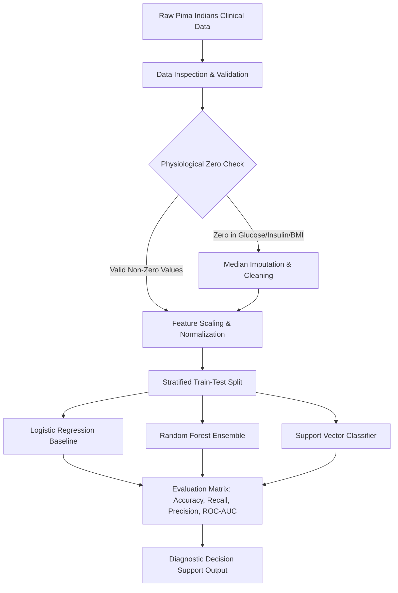

<div align="center">


[](https://www.python.org/)
[](https://scikit-learn.org/)
[](https://pandas.pydata.org/)
[](https://numpy.org/)
[](#)
[](#)

</div>

---

## 📌 Executive Summary / Overview

The **Pima Indians Diabetes Diagnostic Predictor** is a supervised machine learning classification framework designed to assess the diagnostic onset of Type-2 diabetes based on diagnostic and biometric clinical measurements. Utilizing the canonical dataset originally curated by the National Institute of Diabetes and Digestive and Kidney Diseases (NIDDK), this repository implements an end-to-end predictive healthcare pipeline.

In clinical screening contexts, biological values such as serum glucose, blood pressure, and body mass index cannot realistically equal zero; hence, simple omission or ignorance of zeroes skews epidemiological modeling. This project introduces physiological data cleansing, missingness imputation for biological zeros, robust feature standardization, and supervised classification architectures (Logistic Regression, Random Forests, Support Vector Machines) optimized for high clinical recall and diagnostic specificity.

---

## 📖 Interactive Table of Contents

- [Executive Summary / Overview](#-executive-summary--overview)
- [Key Features & Capabilities](#-key-features--capabilities)
- [Clinical Biometric Feature Set](#-clinical-biometric-feature-set)
- [System Architecture & ML Pipeline](#-system-architecture--ml-pipeline)
- [Tech Stack Breakdown](#-tech-stack-breakdown)
- [Reproducible Quickstart & Setup](#-reproducible-quickstart--setup)
- [Project Directory Layout](#-project-directory-layout)
- [Author & Contributions](#-author--contributions)

---

## ✨ Key Features & Capabilities

- **Physiological Anomaly & Zero-Value Treatment**: Detects biologically implausible zero measurements across blood glucose, diastolic blood pressure, triceps skin fold thickness, and serum insulin, replacing them with statistical median imputations.
- **Exploratory Correlation Profiling**: Analyzes multicollinearity and correlation coefficients between Insulin, Glucose, BMI, and Age relative to diabetes diagnosis.
- **Supervised Classification Benchmarking**: Implements and validates linear and ensemble classifiers (Logistic Regression, Decision Trees, Random Forest Classifiers).
- **Clinical Performance Metrics**: Evaluates models prioritizing Recall (Sensitivity) to minimize false negatives in medical screening, alongside ROC-AUC and F1-score curves.
- **Standardized Feature Scaling**: Normalizes variable dimensions using `StandardScaler` to prevent high-magnitude features from dominating gradient updates.

---

## 🩺 Clinical Biometric Feature Set

| Feature Name | Clinical Description | Unit |
| :--- | :--- | :--- |
| `Pregnancies` | Number of times pregnant | Count |
| `Glucose` | Plasma glucose concentration after a 2-hour oral glucose tolerance test | $\text{mg/dL}$ |
| `BloodPressure` | Diastolic blood pressure | $\text{mm Hg}$ |
| `SkinThickness` | Triceps skin fold thickness | $\text{mm}$ |
| `Insulin` | 2-Hour serum insulin | $\mu\text{U/mL}$ |
| `BMI` | Body Mass Index | $\text{kg/m}^2$ |
| `DiabetesPedigreeFunction` | Genetic scoring metric synthesizing familial diabetic history | Continuous score |
| `Age` | Patient age | Years |
| `Outcome` | Diagnostic status (0: Non-Diabetic, 1: Diabetic) | Binary class label |

---

## 🏗️ System Architecture & ML Pipeline



---

## 🛠️ Tech Stack Breakdown

| Category | Technologies & Tools |
| :--- | :--- |
| **Language** | Python 3.9+ |
| **Machine Learning** | Scikit-Learn (LogisticRegression, RandomForest, StandardScaler, Metrics) |
| **Data Manipulation** | Pandas (DataFrames, GroupBy, Imputation), NumPy |
| **Exploratory Visualization** | Matplotlib, Seaborn (Pairplots, Heatmaps, Confusion Matrix) |
| **Development Workflow** | Jupyter Notebook, Python Virtual Environments |

---

## 🚀 Reproducible Quickstart & Setup

### Prerequisites
- Python 3.9 or higher
- Git CLI

### Installation
```bash
# Clone the repository
git clone https://github.com/Jeshwanthika07/PIIMS-Indians-Diabetics.git
cd PIIMS-Indians-Diabetics

# Create and activate virtual environment
python -m venv venv
# On Windows:
.\venv\Scripts\activate
# On Linux/macOS:
source venv/bin/activate

# Install dependencies
pip install numpy pandas scikit-learn matplotlib seaborn jupyterlab
```

### Execution Example
```python
import pandas as pd
from sklearn.model_selection import train_test_split
from sklearn.preprocessing import StandardScaler
from sklearn.ensemble import RandomForestClassifier
from sklearn.metrics import classification_report

# Load dataset and prepare features
url = "https://raw.githubusercontent.com/jbrownlee/Datasets/master/pima-indians-diabetes.data.csv"
columns = ['Pregnancies', 'Glucose', 'BloodPressure', 'SkinThickness', 'Insulin', 'BMI', 'DPF', 'Age', 'Outcome']
df = pd.read_csv(url, names=columns)

X = df.drop('Outcome', axis=1)
y = df['Outcome']

X_train, X_test, y_train, y_test = train_test_split(X, y, test_size=0.2, random_state=42, stratify=y)
scaler = StandardScaler()
X_train_scaled = scaler.fit_transform(X_train)
X_test_scaled = scaler.transform(X_test)

clf = RandomForestClassifier(n_estimators=100, random_state=42)
clf.fit(X_train_scaled, y_train)
y_pred = clf.predict(X_test_scaled)
print(classification_report(y_test, y_pred))
```

---

## 📂 Project Directory Layout

```text
PIIMS-Indians-Diabetics/
│
├── README.md                  # Comprehensive clinical data science documentation
└── requirements.txt           # Python dependency specification
```

---

## 👩‍💻 Author & Contributions

Authored by **[Jeshwanthika Pothamchetty](https://github.com/Jeshwanthika07)**  
*Alliance University, Department of Computer Applications*

<div align="center">


</div>
